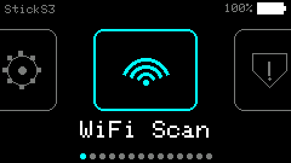
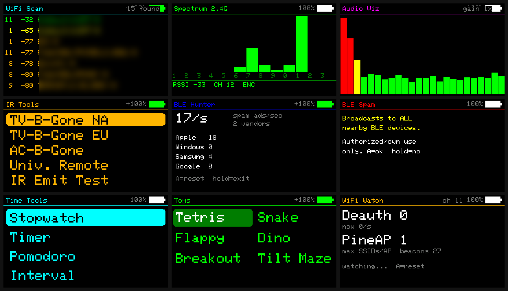

# PocketDeck

[](https://github.com/atahan99/PocketDeck/actions/workflows/build.yml)

Fourteen apps in one flashable firmware for the
[M5Stack StickS3](https://docs.m5stack.com/en/core/StickS3) (ESP32-S3-PICO N8R8,
8 MB PSRAM). No SD card — everything is compiled in and picked from a carousel
launcher. Native M5Unified, from scratch (not a port of the StickC firmwares,
which boot blank on this board).



## Apps

| App | What it does |
|-----|--------------|
| **WiFi Scan** | 2.4 GHz APs: SSID, RSSI, channel, encryption. |
| **WiFi Watch** | Receive-only attack detector: deauth/disassoc-flood counter + PineAP/Karma (one MAC beaconing many SSIDs). Channel-hops 1–13, transmits nothing. |
| **WiFi Spam** | Raw 802.11 beacon flooder — funny/random fake APs. Warning-gated, authorized/own-device use only; beacons only, no deauth/association. |
| **Spectrum** | Promiscuous channel monitor (1–13) + live packet HUD. |
| **Audio Viz** | ES8311 mic → FFT bars. BtnA cycles gain. |
| **IR Tools** | TV-B-Gone, AC-B-Gone (Flipper `ac.ir` codes), Universal Remote (learn on G42 → replay on G46, saved to NVS), Emit Test. |
| **AI Buddy** | Claude Code / Codex / Cursor status, pushed from a host over WiFi or BLE. |
| **BLE Scan** | Passive nearby-device scan. |
| **BLE Spam** | Pairing-popup advertising spam (Apple/Windows/Samsung/Android). Warning-gated, authorized/own-device use only. |
| **BLE Hunter** | Receive-only BLE spam detector: per-vendor advertising rates (Apple/Windows/Samsung/Google Fast Pair) + flood alarm. The counterpart to BLE Spam. |
| **Time** | Stopwatch, Timer (BtnB +1 / double-click −1), Pomodoro, Interval. Offline. |
| **Light** | Full-white flashlight. |
| **Toys** | Tetris, Snake, Flappy, Dino, Breakout, Tilt Maze (IMU). |
| **Settings** | WiFi (off by default; toggle + setup), brightness, Grove 5V, about. |

**Controls.** Two buttons: **BtnA** = select/action, **BtnB** = next, **long-press**
= back. Battery % shows in every header; the screen dims then sleeps on idle (on
battery only, to keep USB flashing alive), and holding power sleeps on demand.

## Legal & responsible use

Some apps transmit: WiFi Spam floods beacon frames, BLE Spam broadcasts pairing
adverts, and IR Tools blasts remote codes. Run these only against devices and
networks you own or have written permission to test.

Transmitting and spoofing on the 2.4 GHz band can be illegal where you live — in
the US under FCC rules, and most countries have an equivalent. The spam tools are
nuisance-class demos (beacons and adverts only; no deauth, no association, no
client attacks), each gated behind an on-device warning, and every radio ships
off by default. None of that is legal cover; where and how you use it is on you.

PocketDeck is a learning and security-awareness project. The receive-only
detectors (WiFi Watch, BLE Hunter) are the point: they let you see the same
attacks from the defender's side.

## Screenshots



## Build & flash

Needs [PlatformIO](https://platformio.org/); the first build pulls the S3 toolchain.

```bash
./scripts/flash.sh            # auto-detects the port
```

Platform pinned to **pioarduino 55.03.311** (arduino-esp32 3.3.11) — see
[gotchas](#gotchas). `firmware/pocketdeck.bin` ships no secrets (WiFi is entered
on-device).

### Drive it from a host

`scripts/stick.py` works the UI over USB serial and returns the screen as a PNG:

```bash
python scripts/stick.py shot            # -> shot.png
python scripts/stick.py key b b a       # BtnB, BtnB, BtnA
python scripts/stick.py logs -s 20      # stream the log
```

`scripts/buddy.py` feeds the AI Buddy app — it tails Claude/Codex/Cursor session
logs and pushes status over WiFi (`wifi`) or BLE (`ble`, needs `pip install bleak`).

## Gotchas

- Prebuilt StickC firmwares boot blank — StickS3 is new; needs M5GFX ≥ 0.2.16.
- Octal PSRAM needs `board_build.arduino.memory_type = qio_opi` or the framebuffer alloc fails.
- Mic (ES8311) needs arduino-esp32 ≥ 3.2.0 (older → GDMA error); BLE needs NimBLE ≥ 2.x (1.4 hangs at init).
- **IR is powered from the EXT_5V rail**, which also coil-whines at idle — so it's off by default and switched on only inside IR Tools. That's why IR is dead elsewhere and buzzes while in use.
- Backlight PWM is moved 256 Hz → 44.1 kHz to stop an audible whine.
- Tilt Maze mirrored? Flip `TILT_SIGN` in `toys.cpp`.

## License & credits

MIT — see [LICENSE](LICENSE). The bundled IR data (TV-B-Gone, Flipper AC codes)
keeps its own terms, and the apps are a from-scratch rebuild inspired by the
ESP32 hobbyist scene (Bruce, GhostBLE, M5Stick-NEMO, and others). Full
attribution and upstream links are in [THIRD-PARTY.md](THIRD-PARTY.md).
