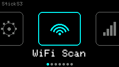

# StickS3 — merged launcher firmware

One firmware, eleven apps, picked from a launcher on the
[M5Stack StickS3](https://docs.m5stack.com/en/core/StickS3) (K150, ESP32-S3-PICO
N8R8). There is no SD card, so everything is compiled in — a single `.bin` you
flash once. Native [M5Unified](https://github.com/m5stack/M5Unified) + LVGL-free
drawing; nothing is a port of the old StickC firmwares (they target the wrong
display/pins and boot blank on this board).

> Part of [m5stack-projects](../). Run all commands from this directory (`stick-s3/`).



*Bruce-style horizontal card carousel — BtnB scrolls, BtnA launches. Screenshots below are captured straight off the device over USB with [`scripts/stick.py`](scripts/stick.py).*

## Apps

| App | What it does |
|-----|--------------|
| **WiFi Scan** | 2.4 GHz APs: SSID, RSSI, channel, encryption. RSSI-colored. |
| **Spectrum** | Promiscuous-mode channel monitor, ch 1–13 decaying bars + live packet HUD (RSSI/channel/ENC·OPEN). |
| **Audio Viz** | Built-in ES8311 mic → FFT → reactive bars for ambient music. BtnA cycles gain. |
| **IR Tools** | **TV-B-Gone** (NA/EU power-code sweep), **AC-B-Gone** (OFF frame per common AC protocol) on G46, and a **Universal Remote** — learn a real remote on G42, replay on G46 (3 slots, persisted to NVS). |
| **AI Buddy** | Claude Code / Codex / Cursor session status, pushed from a host over **WiFi or BLE** (selectable). |
| **BLE Scan** | Passive scan: nearby BLE devices, name/MAC, RSSI-colored. |
| **BLE Spam** | Advertising-beacon spammer (Apple / Windows / Samsung / Android / All) — pairing-popup nuisance demo. **Warning-gated, authorized/own-device use only.** |
| **Time** | Offline time tools: Stopwatch, Timer (BtnB +1 / double-click −1), Pomodoro, Interval (Tabata). No clock/WiFi. |
| **Light** | Flashlight — full-white screen at max brightness. |
| **Toys** | Tetris, Snake, Flappy, Dino (NVS high score), Breakout, Tilt Maze (BMI270). |
| **Settings** | WiFi provisioning (captive portal), brightness, **Grove 5V toggle** (re-enable the boost for a 5V Grove unit), about. |

**Power & persistence.** Battery % + charge state show in every header (glyph
blinks red under 10%). The screen
dims after 20 s idle and, **on battery only**, deep-sleeps after 2 min (wakes on a
button) — it never sleeps on USB so flashing/serial stay alive. Brightness and the
last-opened launcher card persist in NVS.

**Input model.** Two buttons everywhere (BtnA = KEY1/front, BtnB = KEY2/right side):
**BtnA = select/action**, **BtnB = next**, **long-press = back/home**. Apps own
their loop and return to the launcher on a long-press.

**Game controls** (all games: long-press = quit, BtnA = retry after game-over):

| Game | BtnA | BtnB |
|------|------|------|
| Tetris | rotate | move right (wraps to far left, so every column is reachable) |
| Snake | turn left | turn right |
| Flappy | flap | — |
| Dino | jump | — |
| Breakout | paddle left | paddle right |
| Tilt Maze | — | — (tilt the device; flip `TILT_SIGN` in `toys.cpp` if mirrored) |

Physics games run at a fixed ~30 fps — the loop is capped with `frame(33)` so
speed doesn't scale with CPU (uncapped, they were unplayably fast).

## Screenshots

Captured straight off the device over USB with [`scripts/stick.py`](scripts/stick.py):


> **BLE Spam is a nuisance-class demo** of the unsolicited-advertising popup
> vulnerability. It broadcasts to *every* BLE device in range, so it's gated
> behind an on-screen warning and is for authorized testing or your own devices
> only — check your local laws. HID injection ("Bad BLE") is intentionally left
> out: no keyboard on this hardware, and it's a targeted-intrusion feature.

## Hardware

| Piece | Notes |
|-------|-------|
| StickS3 (K150) | ESP32-S3-PICO N8R8: **8 MB flash + 8 MB octal PSRAM**, 135×240 ST7789P3, BMI270 IMU, ES8311 mic, IR TX **G46** / RX G42, 250 mAh battery |
| Power | USB-C, or the small internal battery |

The 8 MB PSRAM is why this device gets a full framebuffer (and clean screenshots)
where the [m5dial](../m5dial) — which has none — needed a tile bridge.

## Build & flash

Needs [PlatformIO](https://platformio.org/). First build downloads the S3
toolchain (~2 min).

```bash
./scripts/flash.sh                    # auto-detects the port
./scripts/flash.sh /dev/cu.usbmodem2101
```

The platform is pinned to **pioarduino 55.03.311 (arduino-esp32 3.3.11)** on
purpose — see [gotchas](#gotchas). The build ships **no secrets**: WiFi is entered
on the device, so `firmware/stick-s3.bin` is a distributable factory image.

### Driving it from a host — screenshots, control, logs

`scripts/stick.py` works the whole UI over USB serial and brings the screen back
as a PNG. Unlike the Dial (no framebuffer, TCP tile bridge), the StickS3 has PSRAM
for a full backbuffer, so a screenshot is just a buffer dump over the cable.

```bash
python scripts/stick.py shot                 # -> shot.png
python scripts/stick.py key b b a            # BtnB, BtnB, BtnA
python scripts/stick.py key home shot        # keys then a screenshot
python scripts/stick.py logs -s 20           # stream the device log
```

Keys are `a` / `b` / `pwr` / `home` — the two buttons plus a synthetic long-press.
Anything a finger can reach is reachable from here. **On the IR page, keys fire
real IR.**

## AI Buddy

Shows Claude Code / Codex / Cursor status as three cards (green idle · yellow
running · red attn). The host bridge tails each CLI's local session logs
read-only and pushes a small JSON blob:

```bash
python scripts/buddy.py wifi           # UDP-broadcast to the device (port 5533)
python scripts/buddy.py ble            # write over Bluetooth (needs: pip install bleak)
python scripts/buddy.py selftest       # verify the state logic, no device
```

Pick the matching transport in the **AI Buddy** app. WiFi mode uses the network
you provisioned in **Settings → WiFi Setup** (captive portal `StickS3-Setup`);
BLE needs no network.

Sources: `~/.claude/projects/*/*.jsonl`, `~/.codex/sessions/**/*.jsonl`,
`~/.cursor/`. State is idle/running from log-file recency.

> **ponytail:** "awaiting approval" isn't reliably detectable from logs across all
> three CLIs, so it's only flagged if a log line literally mentions approval;
> quota isn't in the logs and isn't shown. Cursor's log schema is unstable, so
> its card reports presence/recency only.

## Gotchas

- **Prebuilt StickC firmwares boot blank here.** The StickS3 is a Jan-2026 board;
  M5GFX only autodetects it from **v0.2.16+**. Old images use the wrong panel/pins.
- **Octal PSRAM** needs `board_build.arduino.memory_type = qio_opi`. Wrong value →
  PSRAM never inits and the framebuffer alloc fails (dark screen).
- **Mic needs arduino-esp32 ≥ 3.2.0.** Older cores hit
  `gdma: user context not in internal RAM` — the I2S handle lands in PSRAM and
  GDMA rejects the DMA callback. Fixed in core 3.2.0; we pin 3.3.11.
- **BLE needs NimBLE-Arduino ≥ 2.x.** 1.4.x predates ESP-IDF 5.5 and **hangs** the
  device at BLE host init (wedged, won't auto-reset — single-click power to recover).
- **Idle buzz = the 5V Grove boost, not the amp.** Localized with a layer-by-layer
  sweep (display off, panel sleep, CPU, battery). The amp is held off and the
  display was only a minor contributor; the dominant hum is the **5V Grove boost
  converter**, which M5PM1 leaves **on by default** and which whines while nothing
  is plugged into PORT.A. `main.cpp` calls `M5.Power.setExtOutput(false)` at boot.
  Re-enable it if you attach a 5V-powered Grove unit. Secondary: the backlight PWM
  defaults to **256 Hz** (audible), re-init'd to **44.1 kHz** in the same spot.
- **Tilt sign** in Tilt Maze depends on your grip — flip `TILT_SIGN` in `toys.cpp`
  if it feels mirrored.
- **IR aim:** the G46 emitter is weak; point it at the target. TV-B-Gone timing is
  verified against the code DB, but real-TV range depends on aim.

## Inspiration

The app ideas come from the ESP32 hobbyist-firmware scene — this is a from-scratch
native rebuild for the StickS3, not a port of any of them:

- [Bruce](https://github.com/pr3y/Bruce) / [BruceDevices firmware](https://github.com/BruceDevices/firmware) / [Bruce A-C Edition](https://github.com/tutyr2-jpg/Bruce-A-C-Edition) — IR (TV/AC-B-Gone) and BLE-SPAM
- [GhostBLE](https://github.com/SmonSE/GhostBLE) — BLE advertising spam
- [M5Stick-NEMO](https://github.com/n0xa/m5stick-nemo) — the TV-B-Gone port and RF-tool feel
- [Open-Wifi-Scanner](https://github.com/geo-tp/Open-Wifi-Scanner) — WiFi/spectrum tooling
- [CodeBuddy](https://github.com/CharlexH/CodeBuddy) — the AI-agent status buddy

## Credits & licensing

TV-B-Gone power codes are the canonical **Adafruit / Ken Shirriff port of Mitch
Altman + Limor Fried's** TV-B-Gone firmware (`src/tvbgone_codes.cpp`), *not* the
AGPL Bruce fork — so this stays a clean-licensed personal project. AC OFF frames
come from [IRremoteESP8266](https://github.com/crankyoldgit/IRremoteESP8266).
